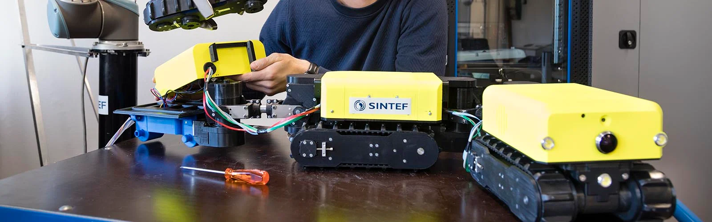

# SINTEF Robotics and Control

Welcome to the GitHub organization for the Robotics and Control group at SINTEF Digital.
Read more about our projects on our [webpage](https://www.sintef.no/en/digital/departments/mathematics-and-cybernetics/robotics-and-control/).

## Open Source Software

As a part of our contract research, we also develop open source software. <!-- These are both developed by our group at SINTEF and in collaboration with industry, academia and other research institutions. Please see the respective webpages listed below for additional details.-->

| Software | Description |
|------|-------------|
| [drone_sim](https://github.com/SINTEF/rpas-simulator) | A skeleton for drone swarm software based on [SEN](https://github.com/airbus/sen). Partners build and test their own SEN components on top of it. The simulator is there to exercise the skeleton: it lets a component run in a realistic multi-drone setup before it goes onto a real vehicle. |

<!-- Hidden for now, but might be needed later:
## Contact

Please contact [Andreas Reason Dahl](mailto:andreas.dahl@sintef.no), Research Manager.
-->

