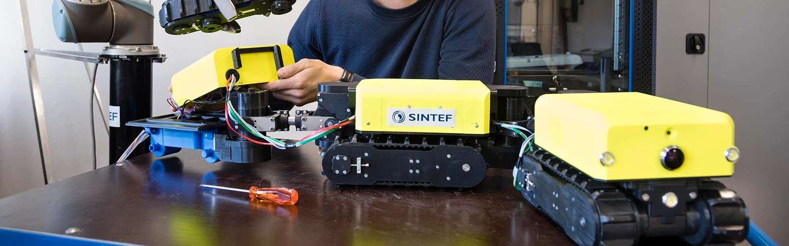

# SINTEF Robotics and Control

Welcome to the GitHub organization for the Robotics and Control group at SINTEF Digital.
Read more about our projects on our [webpage](https://www.sintef.no/en/digital/departments/mathematics-and-cybernetics/robotics-and-control/).

## Open Source Software

As a part of our contract research, we also develop open source software. <!-- These are both developed by our group at SINTEF and in collaboration with industry, academia and other research institutions. Please see the respective webpages listed below for additional details.-->

| Software | Description |
|------|-------------|
| [VirtualFCS](https://github.com/Virtual-FCS/VirtualFCS) | An open Modelica library for dynamic modelling of hydrogen and hybrid energy systems. It brings together electrochemical, electrical, fluid, thermal, control, and vehicle models, with examples ranging from PEM fuel cell vehicles to ammonia cracking. |

<!-- Hidden for now, but might be needed later:
## Contact

Please contact [Andreas Reason Dahl](mailto:andreas.dahl@sintef.no), Research Manager.
-->

